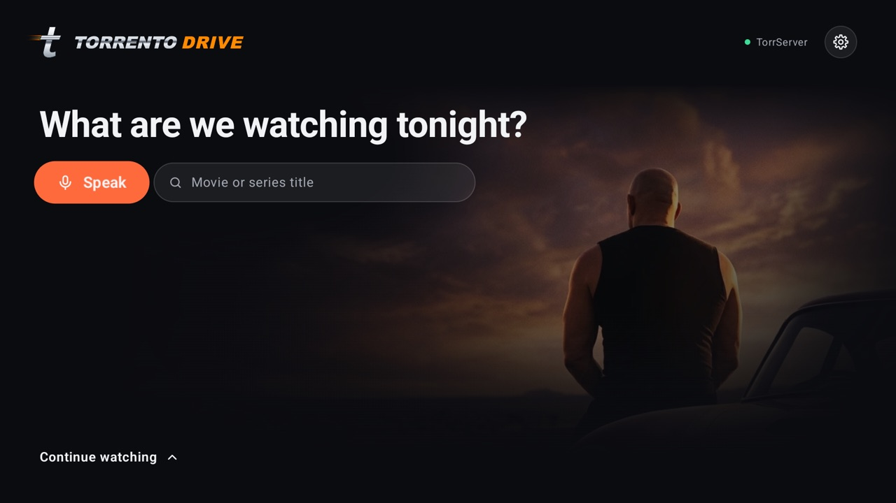
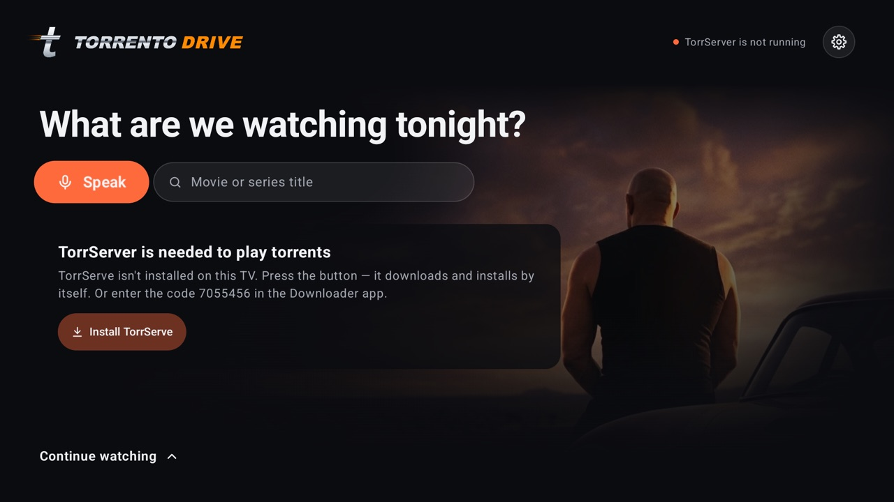
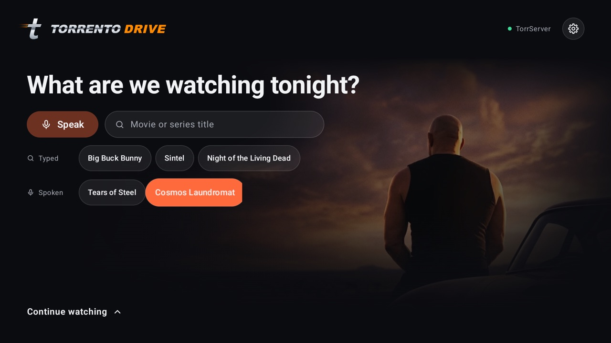
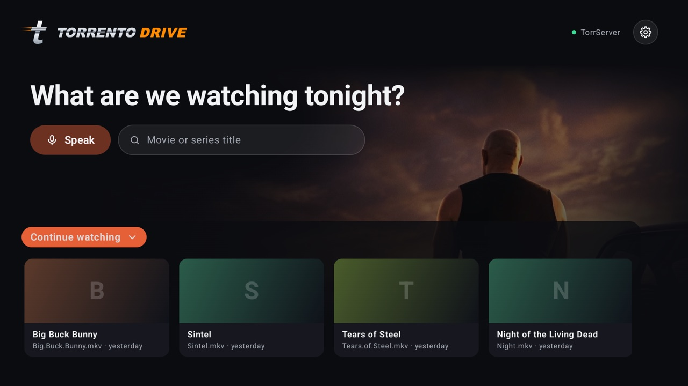
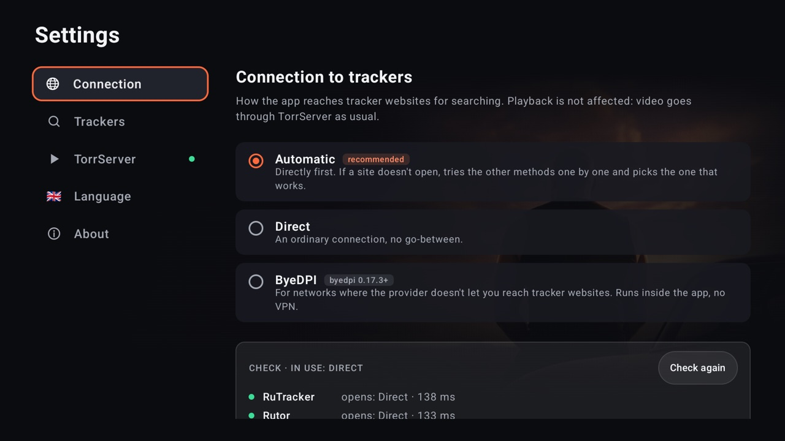

# Torrento Drive

A lightweight Android TV app for watching torrents from the couch: say or type a title, pick
a release, and it starts playing — streamed through
[TorrServer](https://github.com/YouROK/TorrServer), no full download first.

Built for the remote: D-pad navigation everywhere, voice search, a built-in player that goes on
to the next episode by itself, and a "Continue watching" shelf.

**Русская версия: [README.ru.md](README.ru.md)**



## Install on your TV

It takes about five minutes and only the TV remote. You install two apps: **TorrServe** (the
torrent engine) and **Torrento Drive** (this app), both with the free **Downloader** app.

### 1. Install Downloader

On the TV open Google Play (the Amazon Appstore on Fire TV), search for **Downloader**
(by AFTVnews) and install it.

### 2. Install TorrServe

1. Open Downloader. In the field *Enter a URL or Search Term* type the code **`7055456`** and
   press **Go**.
2. The APK downloads. If Android asks whether Downloader may install apps, open the settings it
   offers, allow it, go back and press **Install**.
3. On newer TVs Google Play Protect may say *"Unsafe app blocked — This app was built for an
   older version of Android"*. That is about TorrServe's age, not a virus: open
   **More details** and press **Install anyway**.

### 3. Start the TorrServer inside TorrServe

TorrServe is only a shell — the server itself has to be installed and started once. Without
this step Torrento Drive will keep saying *"TorrServer is not running"*.

1. Open **TorrServe**.
2. In the menu on the left choose **Update**, then press **Install / Update server** and wait
   a few seconds.
3. Done when the address **localhost:8090** at the top left turns green and the server
   version (*MatriX.…*) appears under it.
4. Recommended: in TorrServe **Settings** turn on **Start Server on Boot**, so the server is
   running after the TV restarts too.
5. Press the remote's **Home** button — the server keeps running in the background.

### 4. Install Torrento Drive

1. Back in Downloader, type the code **`6719325`** and press **Go**, then **Install**.
2. Open Torrento Drive from the TV's app list. Allow the microphone for voice search.
3. That's it: press **Speak** and say a title, or type it. Rutor works right away; for
   RuTracker open **Settings** (the gear at the top right) → **Trackers** and sign in on its
   own website.

You can also install Torrento Drive first: if TorrServe isn't there, the home screen has an
**Install TorrServe** button that downloads and installs it (then do step 3). If the server
isn't running, the home screen says so:



### Updates

The app checks GitHub for a new version when it starts and shows an **Update** button next to
the gear. Press it and confirm the installation. **Settings → About** checks on demand.

### Without the codes

Instead of a code you can type the full address into Downloader:

```
https://github.com/nindzyago/torrento-drive/releases/latest/download/torrento-drive.apk
```

Or download `torrento-drive.apk` from
[Releases](https://github.com/nindzyago/torrento-drive/releases/latest) and install it with
`adb install torrento-drive.apk` or from a USB stick with any file manager.

## Screenshots

| Search history | Continue watching | Settings |
|---|---|---|
|  |  |  |

## Features

- **Search several trackers at once.** Results are merged, sorted by seeds and grouped by
  category (movies, series, animation, documentary, sports, music).
- **Voice search** from the remote: "find me Dune in 4K" searches for *Dune* in 2160p. Two
  search histories — what you typed and what you said.
- **Streams instead of downloading.** The torrent is handed to TorrServer; a buffering screen
  shows seeds, peers and speed and the video starts once the buffer is ready.
- **Built-in player** (Media3) with next-episode auto-play and resume where you stopped.
  Any external player can still be used.
- **Continue watching** with posters taken from the release description.
- **Sign in on the tracker's own website.** Trackers that need an account open in a built-in
  browser with a D-pad mouse cursor; the app never sees your password, it only keeps the
  site's session cookies.
- **Settings** behind the gear: connection, trackers (switch each on or off, sign in),
  TorrServer status and install help, language, updates.
- **Pluggable trackers, languages and connection methods** — see
  [CONTRIBUTING.md](CONTRIBUTING.md).

Trackers included today: **RuTracker** (sign-in required) and **Rutor**.
Languages: English and Russian. By default the app follows the system language (English if it
doesn't have it); **Settings → Language** switches it.

### Connection to trackers

Some networks don't let you reach tracker websites. **Settings → Connection** shows which
trackers open and how, and offers:

- **Automatic** (default): directly first; if a tracker doesn't open, the other methods are
  tried one by one and the one that works is used.
- **Direct**: an ordinary connection.
- **ByeDPI**: [byedpi](https://github.com/hufrea/byedpi) runs inside the app (no VPN, no extra
  app) and changes how the start of each connection is sent, which helps where network filters
  recognize tracker sites by name.

Only searching goes this way — tracker pages, `.torrent` files and posters. Video always streams
straight from TorrServer.

## Requirements

- An Android TV / Google TV device, Android 9 (API 28) or newer.
- [TorrServe](https://github.com/YouROK/TorrServe) on the same device with its server running
  (`127.0.0.1:8090`). While it isn't, the home screen explains how to install or start it.
- For voice search: a remote with a microphone and Google speech recognition on the device.

## Build from source

You need JDK 17 and the Android SDK (platform 37.2) with NDK 29.0.14206865 and CMake 3.31.6
(they build byedpi; `sdkmanager "ndk;29.0.14206865" "cmake;3.31.6"`).

```bash
./gradlew testDebugUnitTest assembleDebug
adb connect <tv-ip>:5555
adb install -r app/build/outputs/apk/debug/app-debug.apk
```

A debug build is signed with your local debug key, so it can't be installed over a release
build from GitHub (or the other way round): uninstall one first.

Handy for development — open the app with a query, without voice:

```bash
adb shell am start -n io.github.nindzyago.torrentodrive/.MainActivity --es query "big buck bunny"
```

### Personal background picture

Drop any image at `app/src/main/res/drawable-nodpi/backdrop.png` and rebuild: it replaces the
default picture on the right of the screens, with the same soft edges. The file is git-ignored,
so your picture stays in your own build.

## Releasing (maintainers)

Releases are built and signed by GitHub Actions ([release.yml](.github/workflows/release.yml)).

1. Bump `versionCode` and `versionName` in `app/build.gradle.kts`, add a section to
   [CHANGELOG.md](CHANGELOG.md).
2. Tag and push: `git tag v0.2.0 && git push origin v0.2.0`.
3. The workflow builds `torrento-drive.apk`, signs it and attaches it to a new release.
   `releases/latest/download/torrento-drive.apk` then points to it, so the Downloader code
   never changes.

The signing key lives outside the repository. The workflow reads it from these secrets:
`RELEASE_KEYSTORE_BASE64` (the `.jks` file, base64), `RELEASE_STORE_PASSWORD`,
`RELEASE_KEY_ALIAS`, `RELEASE_KEY_PASSWORD`. Locally the same names go into a git-ignored
`keystore.properties` (with `RELEASE_STORE_FILE` pointing to the `.jks`). **Back the key up:**
an app signed with a different key can't update an installed one.

## How it works

```
voice / keyboard ─► SearchQuery ─► every TrackerProvider.search() in parallel
                                      │
                    pick a release ◄──┘
                         │ TrackerProvider.source(): magnet link or .torrent bytes
                         ▼
                  TorrServer (127.0.0.1:8090) ── file list, stats, preload
                         │ http://127.0.0.1:8090/stream/...
                         ▼
                  built-in player (or an external one)
```

Notes from real devices:

- Some trackers sit behind Cloudflare. Their traffic goes through an in-app WebView — a real
  browser engine — and when Cloudflare asks for a human check, the page is shown with the
  D-pad cursor so you can click it. The app does not try to bypass such checks.
- On some boxes the remote's microphone reaches apps only after the remote audio service has
  rerouted it. `VoiceWarmup` opens the microphone for a moment before starting recognition
  and releases it right away; this makes voice work on such devices.

## Disclaimer

Torrento Drive is a search front-end and a client for a local TorrServer. It does not host,
index or distribute any content. You are responsible for what you search for and play, and
for complying with the laws of your country and the rules of the trackers you use.

"Torrento Drive" is an independent hobby project, not affiliated with any film studio or
franchise.

## License

[MIT](LICENSE). TorrServer and TorrServe are separate projects with their own licenses and
are not bundled. [byedpi](https://github.com/hufrea/byedpi) (MIT, © hufrea) is included unchanged
in `app/src/main/cpp/byedpi`.
