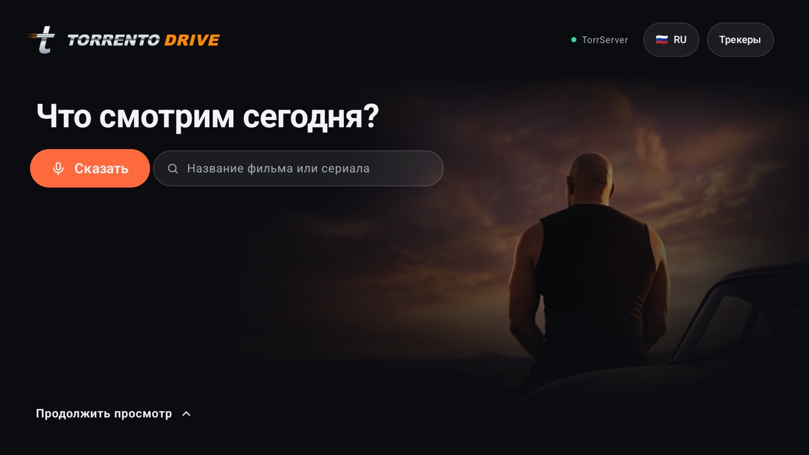
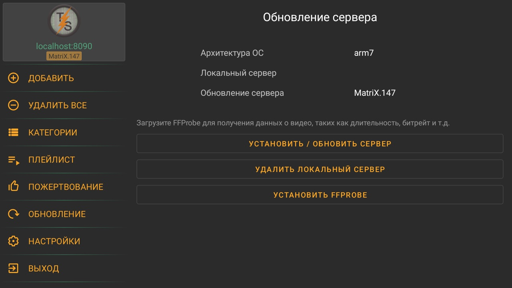
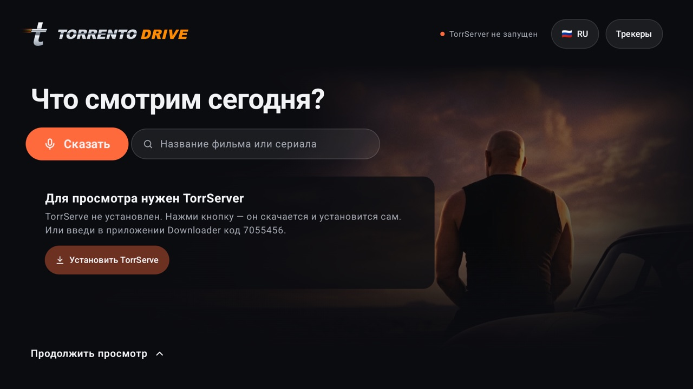
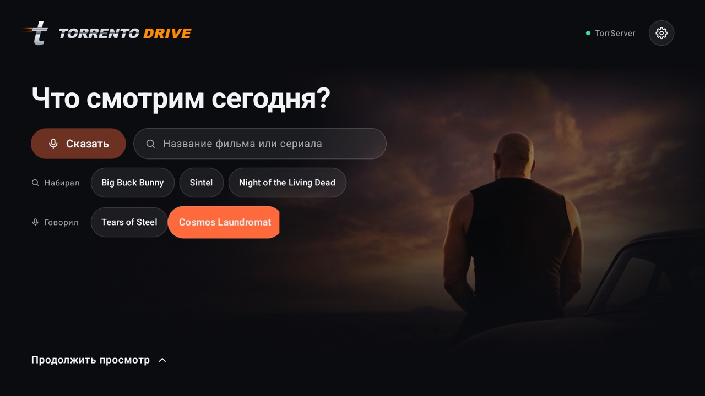
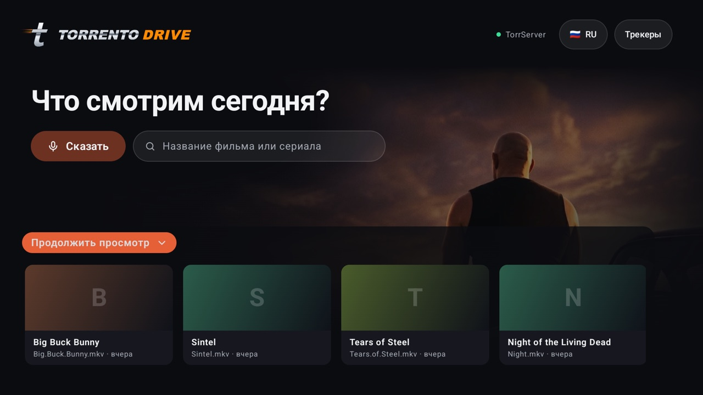
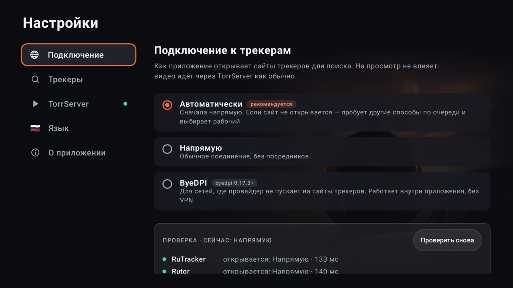

# Torrento Drive

Приложение для Android TV, чтобы смотреть торренты с дивана: скажи или набери название, выбери
раздачу — и видео начнёт играть сразу, через
[TorrServer](https://github.com/YouROK/TorrServer), без полного скачивания.

Всё управляется пультом: голосовой поиск, встроенный плеер, который сам включает следующую серию,
и полка «Продолжить просмотр».

**English version: [README.md](README.md)**



## Как поставить на телевизор

Минут пять и только пульт. Ставятся два приложения: **TorrServe** (торрент-движок) и
**Torrento Drive** (это приложение). Оба — через бесплатное приложение **Downloader**.

### 1. Поставь Downloader

На телевизоре открой Google Play (на Fire TV — Amazon Appstore), найди **Downloader**
(от AFTVnews) и установи.

### 2. Поставь TorrServe

1. Открой Downloader. В поле *Enter a URL or Search Term* введи код **`7055456`** и нажми **Go**.
2. APK скачается. Если Android спросит, можно ли Downloader устанавливать приложения, — открой
   предложенные настройки, разреши, вернись назад и нажми **Установить**.
3. На новых телевизорах Google Play Protect может написать *«Небезопасное приложение
   заблокировано — приложение создано для более старой версии Android»*. Это про возраст
   TorrServe, а не вирус: открой **Подробнее** и нажми **Всё равно установить**.

### 3. Запусти TorrServer внутри TorrServe

TorrServe — это только оболочка, сам сервер нужно один раз установить и запустить. Без этого
шага Torrento Drive будет писать *«TorrServer не запущен»*.

1. Открой **TorrServe**.
2. В меню слева выбери **Обновление**, нажми **Установить / обновить сервер** и подожди
   несколько секунд.
3. Готово, когда адрес **localhost:8090** слева вверху стал зелёным, а под ним появилась версия
   сервера (*MatriX.…*):

   

4. Советую: в **Настройках** TorrServe включи **Запускать сервер при загрузке** — тогда сервер
   будет работать и после перезагрузки телевизора.
5. Нажми на пульте **Домой** — сервер продолжит работать в фоне.

### 4. Поставь Torrento Drive

1. Снова в Downloader введи код **`6719325`**, нажми **Go**, потом **Установить**.
2. Открой Torrento Drive из списка приложений. Разреши микрофон — он нужен для голосового поиска.
3. Готово: нажми **Сказать** и произнеси название или набери его. Rutor работает сразу; для
   RuTracker открой **Настройки** (шестерёнка справа вверху) → **Трекеры** и войди на его сайте.

Можно и наоборот — сначала поставить Torrento Drive: если TorrServe нет, на главном экране будет
кнопка **Установить TorrServe**, она сама его скачает и поставит (потом сделай шаг 3). Если
сервер не запущен, главный экран так и скажет:



### Обновления

При запуске приложение проверяет новую версию на GitHub и показывает кнопку **Обновить** рядом с
шестерёнкой. Нажми её и подтверди установку. Проверить вручную — **Настройки → О приложении**.

### Без кодов

Вместо кода в Downloader можно ввести адрес целиком:

```
https://github.com/nindzyago/torrento-drive/releases/latest/download/torrento-drive.apk
```

Или скачай `torrento-drive.apk` со страницы
[Releases](https://github.com/nindzyago/torrento-drive/releases/latest) и поставь через
`adb install torrento-drive.apk` или с флешки любым файловым менеджером.

## Язык

По умолчанию приложение говорит на языке системы, а если такого языка у него нет — по-английски.
Переключить язык — **Настройки → Язык**. Сейчас есть английский и русский; как добавить
свой — в [CONTRIBUTING.md](CONTRIBUTING.md).

## Скриншоты

| История поиска | Продолжить просмотр | Настройки |
|---|---|---|
|  |  |  |

## Подключение к трекерам

В некоторых сетях сайты трекеров не открываются. **Настройки → Подключение** показывают, какие
трекеры открываются и каким способом, и дают выбрать:

- **Автоматически** (по умолчанию): сначала напрямую; если трекер не открывается — по очереди
  пробуются другие способы, и используется тот, что сработал.
- **Напрямую**: обычное соединение.
- **ByeDPI**: [byedpi](https://github.com/hufrea/byedpi) работает внутри приложения (без VPN и
  отдельных приложений) и меняет то, как отправляется начало каждого соединения. Помогает там, где
  сетевые фильтры узнают сайты трекеров по имени.

Так идёт только поиск — страницы трекеров, `.torrent`-файлы и постеры. Видео всегда идёт напрямую
из TorrServer.

## Что умеет

- Ищет сразу на нескольких трекерах, сортирует по сидам и раскладывает по категориям.
- Голосовой поиск с пульта: «найди фильм Дюна в 4К» ищет «Дюна» в 2160p.
- Не качает файл целиком — смотрит сразу через TorrServer, с экраном буферизации.
- Встроенный плеер: следующая серия сама, продолжение с того же места.
- Экран релиза: постер, описание, год, страна, жанр, режиссёр, актёры, перевод и качество — со
  страницы раздачи на трекере; сиды, размер и скорость раздачи; ниже серии. Сам ничего не
  запускается: кнопка «Смотреть» или «Продолжить · серия N».
- Новинки и популярное каждого трекера: внизу главного экрана вкладки «Новинки» и «Популярное» —
  по 10 раздач в каждом разделе трекера, под его собственными названиями. Видео-разделы включены
  сразу, остальные включаются в Настройки → Трекеры.
- Вход на трекер — на его собственном сайте: пароль приложение не видит.
- Настройки за шестерёнкой: подключение, трекеры (включить, выключить, войти), TorrServer с
  подсказками по установке, язык, обновления.
- Трекеры, языки и способы подключения добавляются отдельными файлами — см.
  [CONTRIBUTING.md](CONTRIBUTING.md).

Сейчас есть трекеры **RuTracker** (нужен аккаунт) и **Rutor**.

## Отказ от ответственности

Torrento Drive — это поиск и клиент для локального TorrServer. Приложение ничего не хранит, не
индексирует и не раздаёт. За то, что ты ищешь и смотришь, и за соблюдение законов своей страны и
правил трекеров отвечаешь ты сам.

## Лицензия

[MIT](LICENSE). TorrServer и TorrServe — отдельные проекты со своими лицензиями, в это приложение
они не входят. [byedpi](https://github.com/hufrea/byedpi) (MIT, © hufrea) входит в приложение без
изменений, в `app/src/main/cpp/byedpi`.
