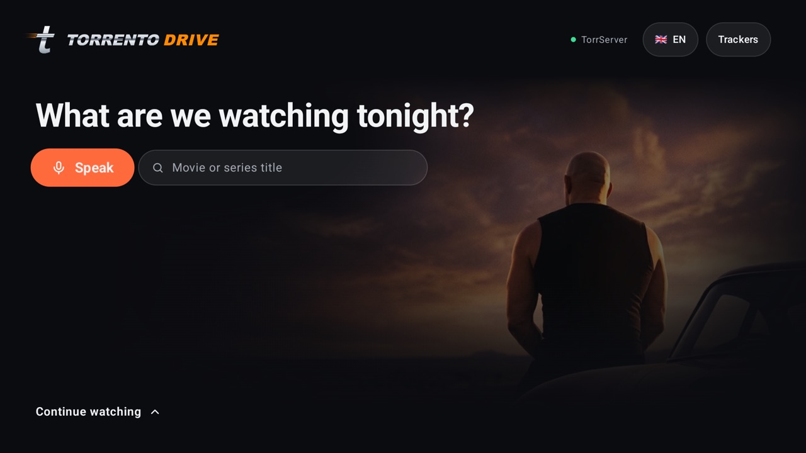
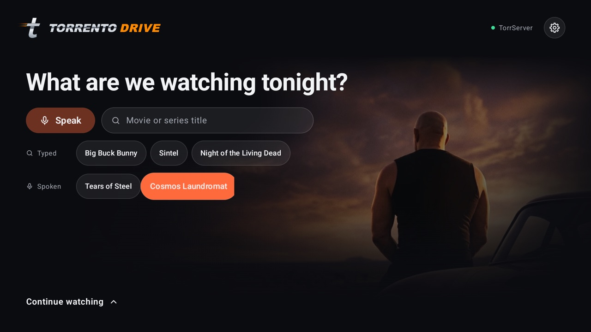
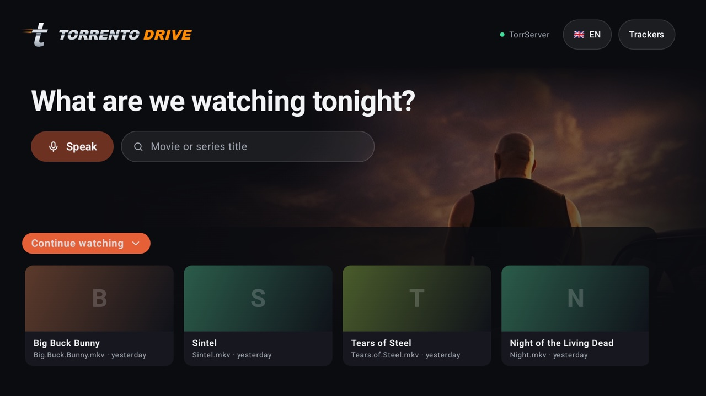
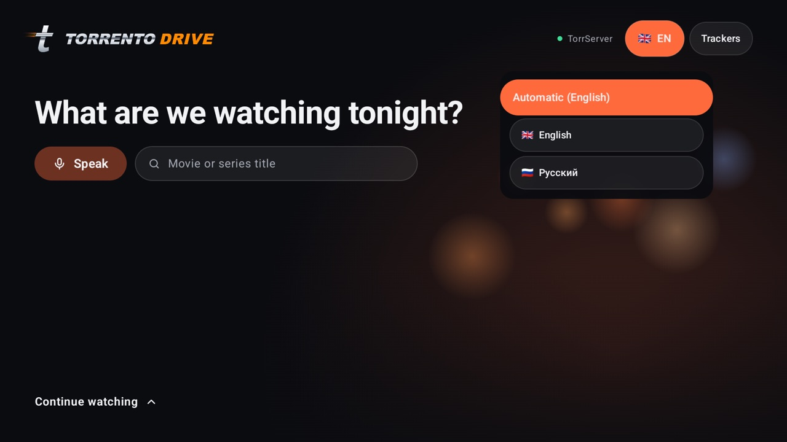

# Torrento Drive

Приложение для Android TV, чтобы смотреть торренты с дивана: скажи или набери название, выбери
раздачу — и видео начнёт играть сразу, через
[TorrServer](https://github.com/YouROK/TorrServer), без полного скачивания.

Всё управляется пультом: голосовой поиск, встроенный плеер, который сам включает следующую серию,
и полка «Продолжить просмотр».

**English version: [README.md](README.md)**



## Как поставить на телевизор

Минут пять и только пульт. Ставятся два приложения: **TorrServe** (торрент-движок) и
**Torrento Drive** (это приложение). Оба — через бесплатное приложение **Downloader**.

### 1. Поставь Downloader

На телевизоре открой Google Play (на Fire TV — Amazon Appstore), найди **Downloader**
(от AFTVnews) и установи.

### 2. Поставь TorrServe

1. Открой Downloader. В поле *Enter a URL or Search Term* введи код **`7055456`** и нажми **Go**.
2. APK скачается. Если Android спросит, можно ли Downloader устанавливать приложения, — открой
   предложенные настройки, разреши, вернись назад и нажми **Install**.
3. Открой TorrServe и проверь, что его сервер запущен. Если он предложит установить или обновить
   сервер — соглашайся.

### 3. Поставь Torrento Drive

1. Снова в Downloader введи код **`6719325`**, нажми **Go**, потом **Install**.
2. Открой Torrento Drive из списка приложений. Разреши микрофон — он нужен для голосового поиска.
3. Готово: нажми **Сказать** и произнеси название или набери его. Rutor работает сразу; для
   RuTracker нажми **Трекеры** и войди на его сайте.

Если TorrServe не установлен, на главном экране будет кнопка **Установить TorrServe** — она
сама скачает и поставит его. Если сервер не запущен, экран подскажет, что делать.

### Обновления

При запуске приложение проверяет новую версию на GitHub и показывает кнопку **Обновить** рядом с
**Трекерами**. Нажми её и подтверди установку.

### Без кодов

Вместо кода в Downloader можно ввести адрес целиком:

```
https://github.com/nindzyago/torrento-drive/releases/latest/download/torrento-drive.apk
```

Или скачай `torrento-drive.apk` со страницы
[Releases](https://github.com/nindzyago/torrento-drive/releases/latest) и поставь через
`adb install torrento-drive.apk` или с флешки любым файловым менеджером.

## Язык

По умолчанию приложение говорит на языке системы, а если такого языка у него нет — по-английски.
Кнопка с флагом справа вверху переключает язык. Сейчас есть английский и русский; как добавить
свой — в [CONTRIBUTING.md](CONTRIBUTING.md).

## Скриншоты

| История поиска | Продолжить просмотр | Язык |
|---|---|---|
|  |  |  |

## Что умеет

- Ищет сразу на нескольких трекерах, сортирует по сидам и раскладывает по категориям.
- Голосовой поиск с пульта: «найди фильм Дюна в 4К» ищет «Дюна» в 2160p.
- Не качает файл целиком — смотрит сразу через TorrServer, с экраном буферизации.
- Встроенный плеер: следующая серия сама, продолжение с того же места.
- Вход на трекер — на его собственном сайте: пароль приложение не видит.
- Трекеры подключаются одним Kotlin-классом — см. [CONTRIBUTING.md](CONTRIBUTING.md).

Сейчас есть трекеры **RuTracker** (нужен аккаунт) и **Rutor**.

## Отказ от ответственности

Torrento Drive — это поиск и клиент для локального TorrServer. Приложение ничего не хранит, не
индексирует и не раздаёт. За то, что ты ищешь и смотришь, и за соблюдение законов своей страны и
правил трекеров отвечаешь ты сам.

## Лицензия

[MIT](LICENSE). TorrServer и TorrServe — отдельные проекты со своими лицензиями, в это приложение
они не входят.
